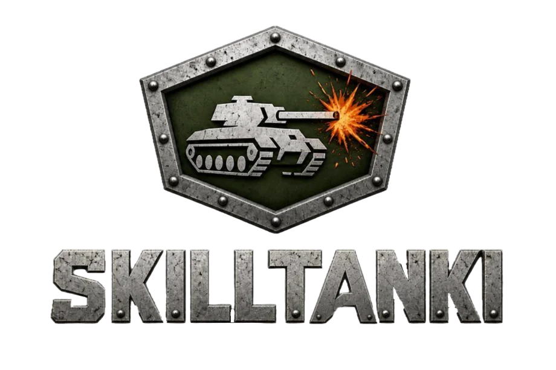
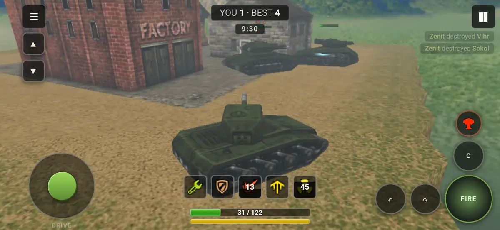
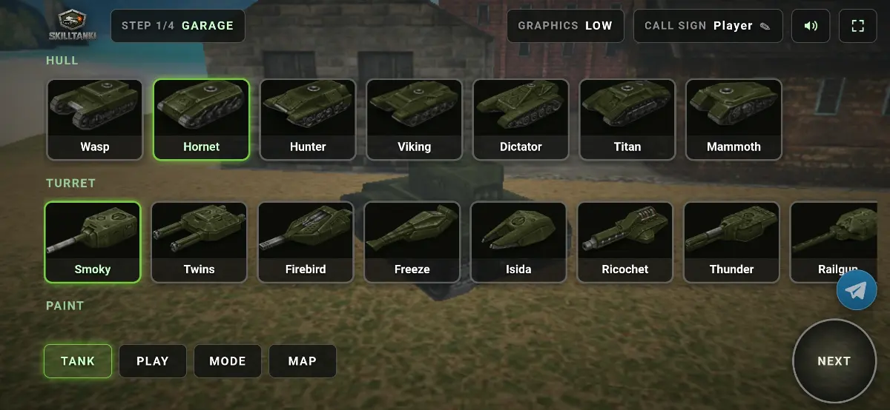
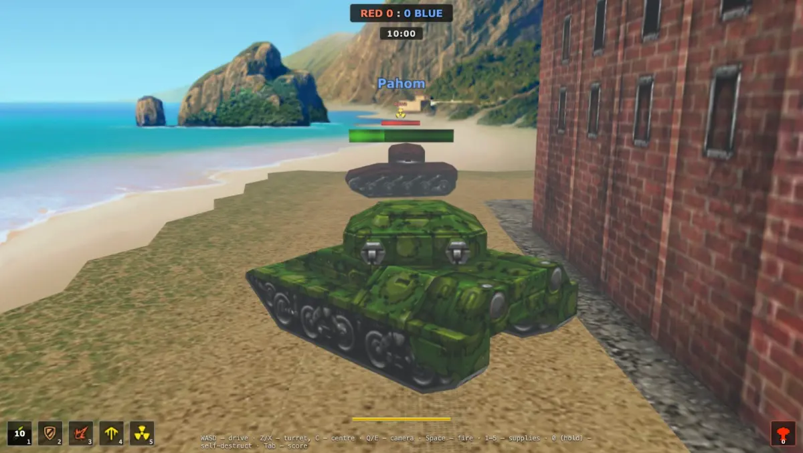
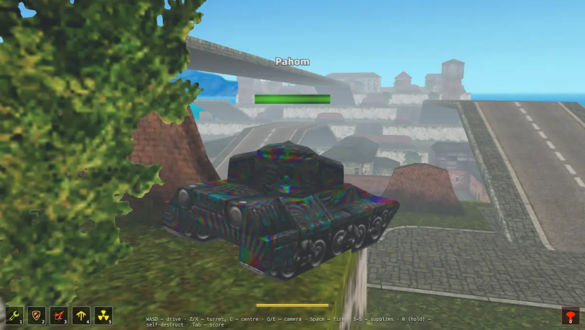
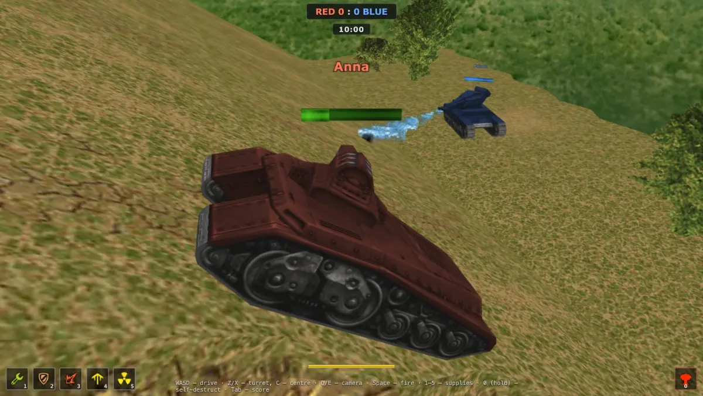
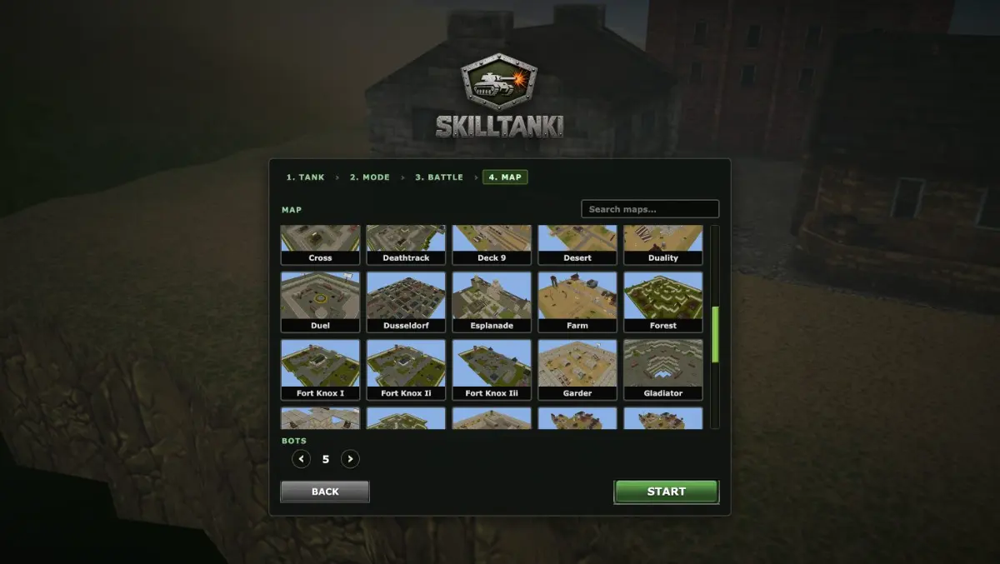
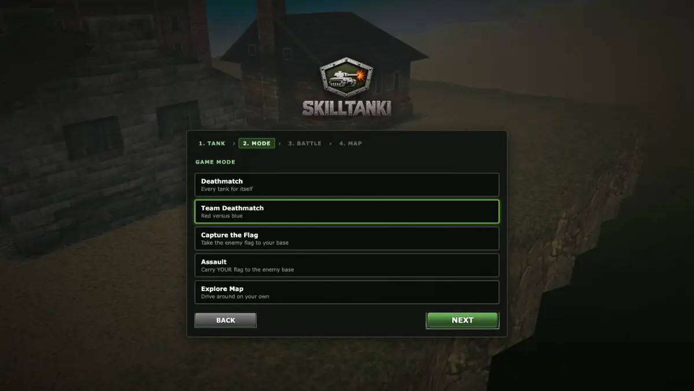
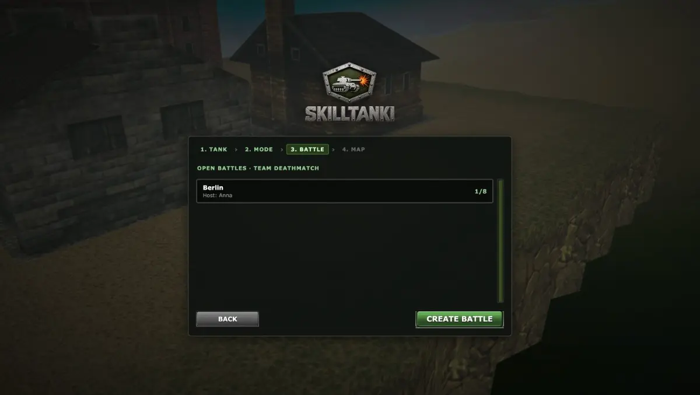
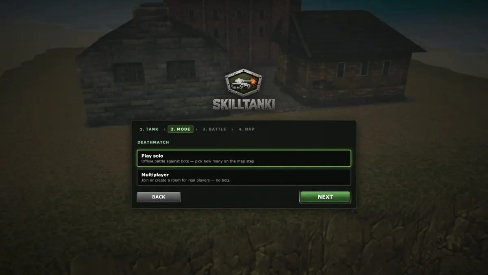

# SkillTanki



A browser tank arcade that brings back the classic 2010 tank game: the angular hulls — Wasp, Hunter, Titan, Dictator — the boxy maps of hangars, garages and sand arenas, and the feel of a heavy machine on suspension that rocks over bumps, flies off ramps and shoves with its sides. Open the page and you are in a battle a few seconds later.

**No registration. No donations. Everything unlocked from the first second.** Pick a call sign, a tank and a map — and play. Alone against bots, or with friends in a password-protected room, or with strangers from the open rooms list.

This repository is the **mobile edition**: a PWA built for phones (touch controls, install to the home screen, gamepad support) that also runs on a desktop browser, plus two interchangeable backends for the lobby and the WebRTC signalling.

## Screenshots

### Mobile (PWA)

| Battle: joystick, Fire and supplies | Garage: hulls and turrets |
| --- | --- |
|  |  |

| New room: mode, bots, password | Map selection |
| --- | --- |
|  |  |

### Desktop

| Beach map | Deck 9 in space | City map with ramps | Red versus blue on the hills | Supplies bar in battle |
| --- | --- | --- | --- | --- |
|  |  |  |  |  |

| Battle over scoreboard | Tank selection | Map selection | Deathmatch: solo or multiplayer | Open battles list |
| --- | --- | --- | --- | --- |
|  |  |  |  |  |

## What is in the game

- **Modes:** Deathmatch, Team Deathmatch, Capture the Flag (bring the enemy flag home), Assault (carry your own flag to the enemy base), and Explore — drive around any map with no fight and no score.
- **7 hulls**, from the fast glass-cannon Wasp to the slow fortress Mammoth. **9 turrets**, each a different way to land damage: instant Smoky, bouncing Ricochet, piercing Railgun, rapid Twins, splash Thunder, the Firebird and Freeze jets (burn, chill), the Isida beam (drain enemies, heal allies), and the Shaft sniper with its charged aimed shot and visible laser.
- **Supplies for everyone, free and unlimited:** repair kit, double armour, double damage, nitro, nuclear energy. The only limit is the cooldown, the same for all. No shop.
- **50+ classic maps**, summer and winter variants, every one open from the start.
- **Balance tuned for skill:** damage spread and falloff, weakened double damage (a Railgun does not one-shot a medium hull even boosted), spawn protection, free spawn points.

## Single player with smart bots

Every mode plays offline too: pick a map, the number of bots (up to 11) and a difficulty, and the battle starts at once — no room, no waiting for anyone. The bots are not turrets on rails:

- **They aim like people.** A reaction delay before the first shot, a wandering aim error that grows against a moving target, a turret that has to traverse, a target lag — all tuned per difficulty (easy / normal / hard) and measured by kill-death ratio against a human.
- **They know the weapon in their hands.** Hitscan guns are fired on target, the Shaft is tapped up close and charged at range, the Isida heals a wounded teammate instead of shooting, jets are held while the target stays in the cone.
- **They drive the map.** A navigation grid is built from the map's geometry on load, paths are found and smoothed, a stuck tank backs out and the spot is remembered as blocked, cliffs and water are avoided, a flipped tank waits to be righted.
- **They play the mode.** Deathmatch bots hunt and pick vantage points; team bots share a blackboard, auction roles, escort and intercept flag carriers, run the flag routes, stage an attack together and ambush where the map hides them. Supplies are used with intent: nitro to chase, armour under fire, a kit when hurt.

## Multiplayer

Players connect to each other directly over **WebRTC** (a full mesh of data channels, up to 12 tanks a room); the backend only matches them and relays the signalling. One player — the **host peer** — is the authority for damage, deaths, respawns, flags, the score and the clock; the others simulate their own tank and replay the host's word. Hit claims are not taken on faith: the host clamps every hit to what that weapon can do, drops hits out of its reach and shots faster than its reload.

- **Rooms** are public (in the list, filtered by mode) or private (password, marked with a lock). Up to 12 players per room, bots can be added and are spread over the players' phones.
- **Host migration:** when the host leaves, the next player becomes the host, the clock continues from the last value, the bots move to the remaining players.
- **Reconnect:** a dropped connection or a page reload brings a player back to the same tank (a bot drives it meanwhile); a player gone for good is replaced by a bot.
- **ICE out of the box:** public STUN plus TURN credentials minted on the fly, so phones behind carrier NAT connect too. On one Wi-Fi the phones talk to each other with no internet at all.

## Controls

Three ways in, all working at once:

- **Touch** — a floating joystick on the left half, Fire, turret, centre, camera and self-destruct buttons on the right, supplies on the HUD.
- **Keyboard** — WASD or arrows to drive, Z/X turret, C centre, Space fire, Q/E camera, 1–5 supplies, 0 self-destruct (hold), Tab score table, Escape pause.
- **Gamepad** (standard mapping, Bluetooth or USB) — left stick drives, right stick turns the turret and tilts the camera, R1 or Cross fires (held: the Shaft's aim), D-pad clockwise = supplies 1–4, R3 nuclear, L3 held = self-destruct, Start pause, Select score table. In the menus the D-pad and left stick are the arrows, Cross is Enter, Circle is Escape. A virtual pad for testing opens with `?gamepad=sim` in development.

## Repository layout

```
apps/mobile/        the game: Vite + TypeScript PWA, PlayCanvas renderer, the ported physics engine (src/engine),
                    di-kit services (lib/tanki: battle, UI, controls; lib/engine: bots; lib/online: multiplayer)
apps/server/        backend v2: Cloudflare Worker — Hono routes, Durable Objects (one per room + the lobby index),
                    KV (TURN cache), R2 (assets), Workers Static Assets (the PWA shell)
packages/backend/   backend v3, self-hosted: Bun + Hono, Redis (rooms, lobby index, pub/sub), MongoDB (room journal),
                    MinIO (assets) — the same protocol, run it on any VPS behind nginx (config/nginx.conf)
assets/             the game data (maps, tanks, textures, sounds; git-lfs) — served by a backend at /assets/*, never bundled
config/nginx.conf   the recommended production front for packages/backend (TLS, static shell, WebSocket, asset cache)
migrate/            one-off data migrations of the Cloudflare backend
scripts/            the root build (build/public = the PWA shell) and the R2 asset uploader
wrangler.jsonc      the production config of the Cloudflare worker
```

The client speaks one protocol to both backends: `GET/POST /api/rooms`, `GET /api/ice`, the signalling socket `/ws/room/:id`, the assets at `/assets/*`. Each package copies the shared types instead of importing across packages, so every package builds and breaks on its own.

## Getting started

Requirements: Node 22, npm (workspaces). For `packages/backend` also Bun 1.2+ and Docker (Redis, MongoDB, MinIO). The game data is in git-lfs: `git lfs pull` before uploading assets.

```bash
npm install

# the Cloudflare backend locally (wrangler dev on :8787) and the game (Vite on :5173, proxies /api, /ws, /assets)
npm run dev:server
npm run upload-assets -- --local          # once: seeds the local R2 bucket from assets/
npm run dev:mobile                        # http://localhost:5173

# the self-hosted backend instead
npm run services -w skilltanki-backend    # docker compose: redis, mongo, minio
npm run upload-assets -w skilltanki-backend   # assets/ into the MinIO bucket
npm run dev:backend                       # bun on :30050
CC_API_PROXY=http://localhost:30050 npm run dev:mobile
```

Checks:

```bash
npm run typecheck                         # all three packages
npm run test:signal                       # two fake peers through the Cloudflare backend (lobby, signalling, host migration, rejoin)
npm run test:backend                      # the same against packages/backend
# bots: a benchmark battle with a JSON report
open "http://localhost:5173/?bench=ctf&map=island_old_summer&bots=6&seconds=180&seed=1"
```

Deploy:

```bash
npm run upload-assets                     # once: assets/ into the R2 bucket (S3 keys in the environment, or --wrangler)
npm run deploy                            # build the PWA shell, then wrangler deploy (the worker + the shell, one origin)
```

For the self-hosted path build the shell with `npm run build:mobile`, run `packages/backend` under its supervisor (`npm run start -w skilltanki-backend`, one process per port) and put `config/nginx.conf` in front of it.

## Development aids

- `globalThis.tanki` (the game's services), `globalThis.online` (multiplayer), `globalThis.engine` (bots) in the browser console.
- `?bench=<mode>&map=<id>&bots=<n>&seconds=<s>&seed=<n>` — a headless bot battle with a report (drownings, captures, stuck events, path failures, tick time).
- `?rooms=mock` — the rooms list with a fixture, for layout work.
- `?gamepad=sim` — a virtual gamepad in a popup, driven with the pointer, read through the real Gamepad API.
- `?debug=nav` — the navigation grid overlay.

## Tech stack

TypeScript everywhere. **Client:** Vite, PlayCanvas (WebGL), a TypeScript port of the original AS3 physics and weapons, di-kit for dependency injection, vite-plugin-pwa, WebRTC. **Cloudflare backend:** Hono, Durable Objects (SQLite), KV, R2, Workers Static Assets, wrangler. **Self-hosted backend:** Bun, Hono, ioredis, mongoose, minio, pinolog. Playwright drives the end-to-end checks of the game and the multiplayer.
